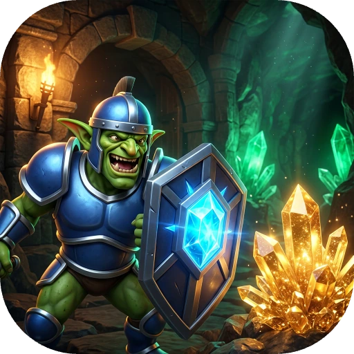
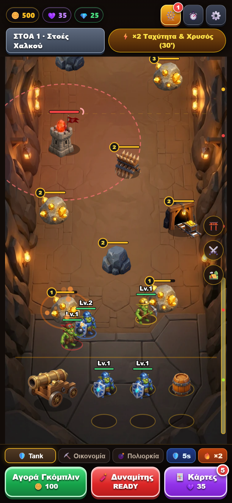
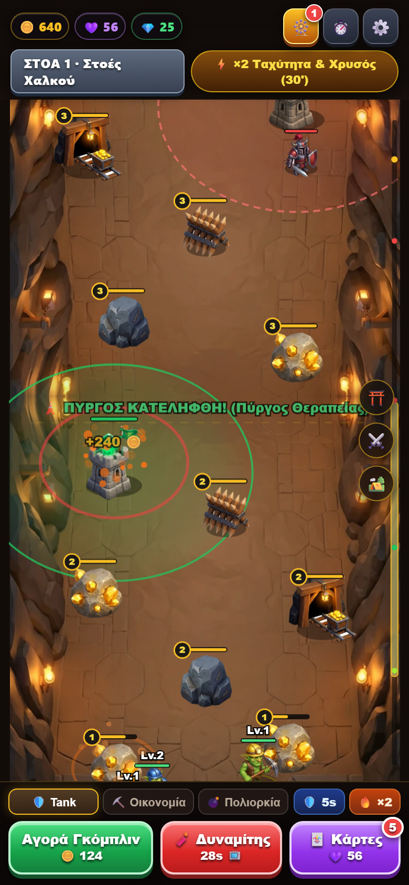
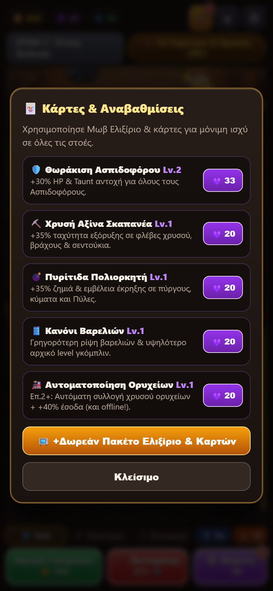
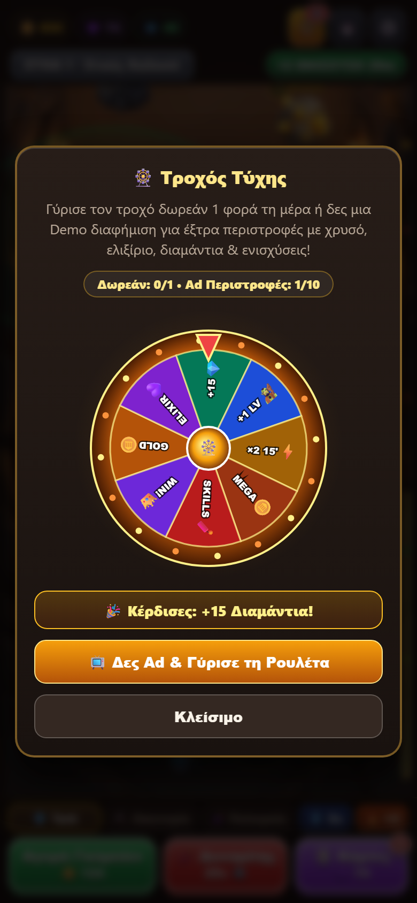
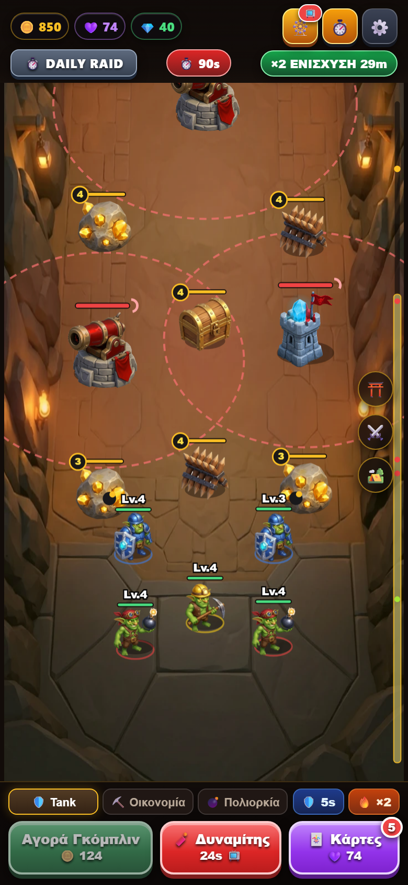
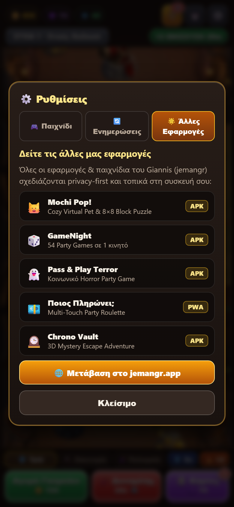

# 🏰 Bastion Breaker

  
  &nbsp;&nbsp;&nbsp;&nbsp;
  

  <strong>Hybrid Idle-Merge Mining &amp; Tactical Tower Siege for Android</strong> 
  <em>Dig for gold, merge your Goblin squad, crush Iron Legion waves, and flip enemy towers to your side!</em>

  
  

  
  
  
  
  

---

## 📥 Direct APK Download

Always get the latest official Android APK build from this permanent link:

👉 **[Download bastion-breaker.apk (Latest Release)](https://github.com/jemangr/bastion-breaker-releases/releases/latest/download/bastion-breaker.apk)** 👈

*(Or view all versions on the [GitHub Releases Page](https://github.com/jemangr/bastion-breaker-releases/releases).)*

---

## ✨ Key Highlights (`v1.1.0`)

- 📜 **Vertical-Scrolling Multi-Zone Caverns:** Swipe smoothly from your Siege Camp through 3 fortified subterranean zones up to the Boss Gate, with touch inertia, edge auto-scroll when dragging goblins, a vertical depth minimap, and quick-jump camera buttons (`⛩️` / `⚔️` / `🏕️`).
- ⛏️ **Idle-Merge Mining + Barrel Cannon:** Tap supply barrels, buy units, and drag matching goblins (`Lv.N + Lv.N → Lv.N+1`) to upgrade and heal 100% HP mid-combat across deeper, longer-paced Mines.
- 🎡 **Ad-Powered Lucky Roulette:** Claim 1 free daily spin or watch Demo Rewarded Ads to spin the 8-prize Fortune Wheel for Gold, Purple Elixir, Gems, Bonus High-Level Goblins, `×2` Boost, and Skill Refills!
- 🛡️ **3 Goblin Classes & Deeper Combat Balance:** *Shield Tank* (`Taunt`), *Miner* (`×3` excavation), and *Siege Bomber* (`×2.3` splash), fighting against guarded Boss Gates (`-50%` Gate Shield while ≥2 towers stand).
- 🗼 **Tower Flip & Marching Knight Waves:** Every enemy tower (Archer, Cannon, Ice, Tesla) shoots & deploys Iron Legion Knight waves — destroy a tower to flip it emerald green into a Healing, Bombardment, Haste, or `×2` Gold support tower!
- 🔊 **Warm Mastered Combat Audio:** Filtered & throttled Web Audio SFX with `DynamicsCompressor` limiting and cozy cavern harp music.
- 🃏 **5 Underground Realms, Cards & Offline Idle:** Progress through *Copper Tunnels* to *Iron King's Citadel*, upgrade Cards with Purple Elixir, automate mineshafts, and earn offline gold.
- ⏱️ **Daily 90" Tower Raid:** Compete on a globally seeded daily siege layout for 🥉/🥈/🥇 medals.
- 🔄 **Automatic 6-Hour Update Checker:** Checks `version.json` silently every 6 hours + one-tap check in Settings, with an **Our Other Apps** link to [jemangr.app](https://jemangr.app).
- 🇬🇷 / 🇬🇧 **Bilingual (EL / EN) & Offline-First:** Plays offline with local on-device saves.

---

## 📸 Screenshots Gallery

| 1. Mining, Merge & Siege | 2. Tower Flip & Knight Waves | 3. Elixir Cards & Upgrades |
| :---: | :---: | :---: |
|  |  |  |

| 4. Ad-Powered Lucky Roulette | 5. Daily 90" Tower Raid | 6. Settings & Other Apps (`jemangr.app`) |
| :---: | :---: | :---: |
|  |  |  |

---

## 🛠️ Android Installation

1. Download **[bastion-breaker.apk](https://github.com/jemangr/bastion-breaker-releases/releases/latest/download/bastion-breaker.apk)** on your Android device (`Android 8.0+`).
2. Open the downloaded `.apk` file.
3. If prompted, allow installation from this source once.
4. Launch **Bastion Breaker** and start your siege!

---

## 📄 License & Ownership

**Copyright (c) 2026 Giannis. All rights reserved.**  
Exclusive owner & developer: **Giannis** (`contact@jemangr.app` · [jemangr.app](https://jemangr.app)).
